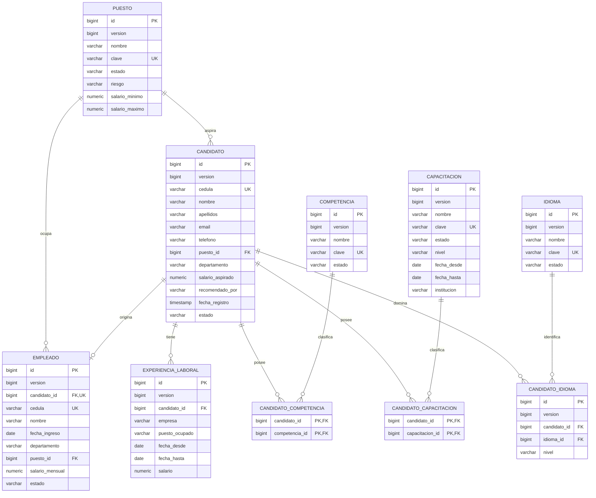

# Modelo relacional

El esquema real se crea con `src/main/resources/db/migration/V1__modelo_reclutamiento.sql`. Flyway controla versiones y Hibernate valida el resultado. El mismo SQL se prueba con PostgreSQL y H2 en modo PostgreSQL.

## Restricciones e integridad

- Todas las entidades tienen PK identity BIGINT y versión para bloqueo optimista. Las tablas N:M usan PK compuesta.
- Candidato.cedula, empleado.cedula y empleado.candidato_id son únicos.
- candidato_idioma tiene UNIQUE(candidato_id, idioma_id). Su entidad intermedia añade nivel de dominio.
- Todas las relaciones obligatorias usan FK y NOT NULL. Las FK no propagan la eliminación de catálogos.
- Los catálogos tienen nombre y clave normalizada única. En competencias y capacitaciones, `nombre` almacena la descripción que se muestra en la interfaz.
- CHECK valida estados, niveles, riesgo, fechas ordenadas y salarios. Tipos monetarios NUMERIC(14,2).
- La fecha final de experiencias/capacitaciones, el teléfono y la recomendación son opcionales.
- Los departamentos son textos requeridos, tal como permite el requerimiento; no se añade otro catálogo.
- Competencias y capacitaciones son @ManyToMany. Los idiomas tienen entidad intermedia @OneToMany por incluir nivel.
- ExperienciaLaboral usa @ManyToOne a Candidato; la colección usa cascade ALL y orphanRemoval para quitar experiencias desde el formulario.
- Empleado usa @OneToOne a Candidato y @ManyToOne a Puesto. Su nombre es una copia del nombre completo al contratar.
- Todas las colecciones se cargan dentro de servicios. Las consultas paginadas evitan un fetch join de colecciones que pagine en memoria.

## Índices

Además de los creados por PK y UNIQUE, se indexan candidato.puesto_id, candidato.estado, candidato.fecha_registro, candidato.departamento; las FK inversas de las tablas de competencias, capacitaciones e idiomas; experiencia_laboral.candidato_id; empleado.fecha_ingreso, empleado.puesto_id y empleado.departamento.

Los filtros por texto usan LIKE sin distinguir mayúsculas. Los filtros combinados por relaciones generan joins y DISTINCT para evitar duplicar candidatos. La búsqueda por texto con comodín inicial prioriza flexibilidad para el volumen universitario; no se agrega un motor de búsqueda externo.

## Contratación atómica

1. Validar el DTO.
2. SELECT del candidato con bloqueo de escritura pesimista.
3. Validar elegibilidad, inexistencia de empleado por candidato/cédula y puesto activo.
4. Construir empleado con copia de identidad y los datos laborales definitivos.
5. Actualizar estado del candidato a CONTRATADO.
6. Guardar y confirmar la misma transacción.

La prueba de rollback fuerza una restricción CHECK al insertar al empleado y comprueba que no se conserva el cambio de estado. La prueba concurrente dispara dos solicitudes y verifica que una sola tiene éxito.

## Baja lógica

Los catálogos y empleados se inactivan; nunca se borran físicamente desde la aplicación. Un candidato se archiva mediante RECHAZADO y puede volver a evaluación. Los candidatos contratados conservan su historial. Solamente se eliminan físicamente las experiencias y asociaciones que el usuario quite al editar un candidato no contratado.
