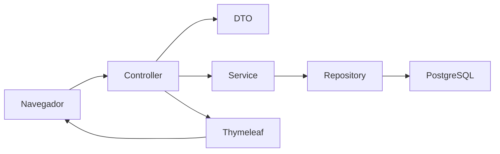

# Reporte de entrega

**Sistema de Reclutamiento y Selección de Recursos Humanos · Universidad APEC**  
**Fecha de verificación:** 30 de septiembre de 2026  
**Ubicación:** `C:\Users\Ian\Documents\Proyecto final`

## 1. Resumen

Aplicación funcional construida desde cero en la carpeta solicitada. Incluye todos los módulos de gestión, relaciones persistentes, consultas, contratación transaccional y reporte. Los datos se almacenan en base de datos; los ejemplos son semillas identificadas como demostración.

La aplicación se entrega con código fuente, Maven Wrapper, configuración PostgreSQL, perfil H2 persistente, migración Flyway, recursos Bootstrap locales, pruebas, documentación y JAR ejecutable.

## 2. Arquitectura

Monolito MVC organizado por capas:



- Los controladores reciben formularios y preparan vistas.
- Los DTO validan campos y limitan los datos modificables.
- Los servicios ejecutan las reglas y transacciones.
- Los repositorios JPA y Specifications consultan la base.
- Flyway controla el esquema; Hibernate lo valida.
- H2 se usa en demostración y pruebas rápidas; PostgreSQL es la configuración principal.

## 3. Entidades y relaciones

| Entidad            | Relación principal                                          |
| ------------------ | ----------------------------------------------------------- |
| Competencia        | N:M con Candidato                                           |
| Idioma             | 1:N con CandidatoIdioma                                     |
| Capacitacion       | N:M con Candidato                                           |
| Puesto             | 1:N con Candidato y Empleado                                |
| Candidato          | Origen de la postulación y las relaciones                   |
| CandidatoIdioma    | Vincula candidato e idioma, con nivel y UNIQUE del par      |
| ExperienciaLaboral | N:1 con Candidato; eliminación de filas huérfanas al editar |
| Empleado           | 1:1 con Candidato, N:1 con Puesto                           |

Todas las entidades tienen PK identity y versión de concurrencia. Las tablas intermedias N:M tienen claves primarias compuestas. Ver [modelo y diagrama ER](database.md).

## 4. Módulos

Dashboard; competencias; idiomas; capacitaciones; puestos; candidatos; experiencias; perfil y selección; contratación; empleados; consulta avanzada; reporte de nuevos ingresos con impresión y CSV.

Los catálogos tienen alta, lectura, edición y eliminación lógica mediante inactivación/reactivación. En candidatos se utiliza RECHAZADO para archivar una postulación. Los empleados se crean exclusivamente mediante contratación.

## 5. Reglas implementadas

- Cédulas obligatorias, normalizadas y únicas en aplicación y base.
- Nombres de catálogos únicos mediante clave normalizada.
- Campos requeridos, longitudes, correo, formato de cédula y precisión monetaria.
- Fechas ordenadas y salarios válidos.
- Puestos y asociaciones nuevas exclusivamente activos.
- Conservación de relaciones históricas cuando un catálogo se inactiva.
- Contratación con bloqueo pesimista y una sola transacción.
- No contratar dos veces, ni forzar manualmente CONTRATADO.
- Rollback ante un fallo de creación del empleado.
- Vinculación única entre candidato y empleado.
- Control de versión en ediciones para impedir sobrescrituras.
- Filtros combinables, paginación y ordenamiento permitido.
- Reportes con límites de fecha inclusivos y suma BigDecimal.
- CSV con escape de comillas, UTF-8 y protección contra fórmulas.
- Validaciones visibles que conservan los valores enviados.
- CSRF en todas las mutaciones, errores legibles y vistas 404/500.

## 6. Rutas

`/`, `/competencias`, `/idiomas`, `/capacitaciones`, `/puestos`, `/candidatos`, `/consultas`, `/empleados`, `/reportes/nuevos-ingresos`.

Cada catálogo incluye `/nuevo`, `/{id}`, `/{id}/editar`. Candidatos incluye además `/{id}/contratar`. La exportación está en `/reportes/nuevos-ingresos/csv`.

## 7. PostgreSQL y ejecución

La configuración principal espera:

- DB_URL: `jdbc:postgresql://localhost:5432/rh_reclutamiento`
- DB_USERNAME: `rh_user`
- DB_PASSWORD: `rh_local`

Crea el usuario/base como explica el README, o inicia `docker compose up -d --wait` con Docker operativo.

```powershell
# PostgreSQL
.\mvnw.cmd spring-boot:run

# Demostración persistente H2
.\mvnw.cmd spring-boot:run "-Dspring-boot.run.profiles=dev"

# Después de compilar con clean package
java -jar target\reclutamiento-1.0.0.jar --spring.profiles.active=dev
```

Acceso: [http://localhost:8080](http://localhost:8080). También se incluye `iniciar-demo.cmd`.

## 8. Pruebas creadas y resultados

> **Actualización QA:** después de los resultados históricos de esta sección se añadieron pruebas de cédula, correo, teléfono y filtros. La suite actual contiene 53 ejecuciones. Consulta `docs/qa-validaciones.md` y vuelve a ejecutar `mvnw.cmd test` para obtener el resultado del código actualizado.

La suite contiene **48 ejecuciones de prueba**, incluyendo casos parametrizados para todas las páginas principales. La misma suite se ejecutó sobre dos motores.

| Comando ejecutado               | Motor / objetivo               | Resultado                                           |
| ------------------------------- | ------------------------------ | --------------------------------------------------- |
| `mvnw.cmd test`                 | H2 aislado                     | **BUILD SUCCESS · 48 pruebas, 0 fallos, 0 errores** |
| `mvnw.cmd -Ppostgres-test test` | PostgreSQL 14.22 real temporal | **BUILD SUCCESS · 48 pruebas, 0 fallos, 0 errores** |
| `mvnw.cmd clean package`        | Pruebas + JAR ejecutable       | **BUILD SUCCESS**                                   |

Los comandos equivalen a `mvn test` y `mvn clean package` usando la versión de Maven fijada por el Wrapper.

Cobertura funcional:

- Duplicado de cédula normalizada y restricción UNIQUE SQL.
- Creación de empleado y cambio de estado.
- Segundo intento de contratación y dos solicitudes concurrentes.
- Fallo real de CHECK al insertar empleado y rollback.
- Estados prohibidos y candidato rechazado.
- Salarios negativos/cero y fecha de ingreso requerida.
- Fechas invertidas de capacitación y experiencia.
- Máximo salarial inferior al mínimo.
- Duplicados de catálogo con mayúsculas, espacios y acentos.
- Alta/edición/inactivación/reactivación.
- Rechazo de puesto, competencia, idioma o capacitación inactivos.
- Conservación de asociaciones históricas.
- Relaciones persistentes, edición y eliminación de experiencias/idiomas.
- Consulta combinada, paginación y ordenamiento.
- Edición con versión obsoleta.
- Reporte inclusivo, exclusión fuera del rango y total salarial.
- Edición, filtros e inactivación del empleado.
- CSV con comillas y fórmula.
- Páginas principales, detalles y formularios renderizados.
- Conservación de datos ante validación fallida.
- POST con CSRF, contratación HTTP, descarga CSV y 404.

La prueba de rollback produce intencionalmente un error SQL en la salida; ese caso termina correctamente cuando la base queda sin empleado y el candidato conserva su estado anterior.

## 9. QA en navegador

Se verificó sobre la aplicación en ejecución:

1. Dashboard con datos recuperados de la base.
2. Registro de un candidato ficticio con Java, SQL, Inglés avanzado, capacitación y experiencia.
3. Apertura del perfil y comprobación de todas las relaciones.
4. Edición de experiencia, adición de una segunda fila y eliminación de esa fila antes de guardar.
5. Contratación con modal de confirmación.
6. Empleado creado con el salario indicado y estado ACTIVO.
7. Mensaje de éxito que confirma el cambio del candidato a CONTRATADO.
8. Reporte por fechas con el nuevo empleado, conteo y suma.
9. Descarga CSV y verificación del contenido.
10. Interfaz a 390 × 844: menú móvil y ausencia de desbordamiento de página.
11. Consola del navegador sin errores ni advertencias en el flujo revisado.

La base utilizada durante ese recorrido se conservó en `.qa/reclutamiento-qa.mv.db`. El modo de demostración final arranca con las semillas originales. Los registros iniciales se crean usando los servicios reales.

## 10. Decisiones importantes y alcance

- Autenticación de demostración habilitada con Spring Security. Usuario: `admin123`; contraseña: `admin123`. El acceso al resto de la aplicación requiere sesión autenticada y existe cierre de sesión.
- Se escucha por defecto únicamente en 127.0.0.1.
- Sin microservicios, colas ni dependencias de servicios externos.
- Bootstrap y sus iconos se sirven localmente.
- Los catálogos comparten formularios/vistas y una base Java para evitar duplicación; conservan tablas y repositorios separados.
- El enum común de catálogos utiliza ACTIVO/INACTIVO.
- Los contratados conservan un perfil histórico de solo lectura; los datos laborales se editan en Empleados.
- No se valida el dígito verificador de la cédula, sino formato y unicidad.
- Las fechas de ingreso futuras son válidas para incorporaciones programadas.
- No se genera PDF; se ofrece impresión optimizada, como permite el requerimiento.
- PostgreSQL fue probado mediante una instancia temporal real. El servidor persistente PostgreSQL requiere crear la base o iniciar Compose; la demostración local entregada utiliza H2.

## 11. Archivos principales

- `pom.xml`, `mvnw`, `mvnw.cmd`: dependencias, build y ejecución.
- `compose.yaml`, `.env.example`: configuración PostgreSQL.
- `iniciar-demo.cmd`: inicio de demostración.
- `src/main/resources/application*.properties`: perfiles.
- `src/main/resources/db/migration/V1__modelo_reclutamiento.sql`: esquema.
- `src/main/java/edu/unapec/rh/service/impl/ContratacionServiceImpl.java`: operación atómica.
- `src/main/java/edu/unapec/rh/repository/ConsultaSpecifications.java`: filtros combinables.
- `src/main/java/edu/unapec/rh/config/DemoSeeder.java`: demostración idempotente.
- `src/main/resources/templates/`: todas las pantallas.
- `src/main/resources/static/css/app.css`, `static/js/app.js`: diseño e interacción.
- `src/test/java/edu/unapec/rh/SistemaIntegrationTest.java`: suite.
- `src/postgres-test/java/edu/unapec/rh/PostgresIntegrationTest.java`: suite PostgreSQL.
- `target/reclutamiento-1.0.0.jar`: artefacto ejecutable generado por `mvnw.cmd clean package`.
- `README.md`, `docs/database.md`, `docs/plan.md`: documentación.

## 12. Checklist final

- [x] Java 21, Spring Boot 3, Maven, JPA, MVC y Thymeleaf.
- [x] Arquitectura por capas y DTO.
- [x] Base principal PostgreSQL y perfil H2 persistente.
- [x] Migración, PK, FK, UNIQUE, NOT NULL, CHECK e índices.
- [x] Dashboard con seis indicadores y listas reales.
- [x] Competencias: CRUD lógico, búsqueda, estado y detalle.
- [x] Idiomas: CRUD lógico y relación con nivel.
- [x] Capacitaciones: CRUD lógico, fechas y filtros.
- [x] Puestos: CRUD lógico, riesgos y salarios.
- [x] Candidatos: registro, detalle, edición y estados.
- [x] Experiencias múltiples con alta, edición y eliminación.
- [x] Relaciones N:M funcionales.
- [x] Selección y contratación transaccional.
- [x] Empleado creado y candidato CONTRATADO.
- [x] Prevención de duplicados y concurrencia.
- [x] Empleados: detalle, edición, estado y filtros.
- [x] Consulta combinada de candidatos.
- [x] Contador, limpieza, paginación y orden.
- [x] Reporte por fechas con conteo y total.
- [x] CSV e impresión.
- [x] BigDecimal y formato RD$.
- [x] Validación backend/frontend y conservación de formularios.
- [x] Modal para operaciones de cambio de estado y contratación.
- [x] Manejo de errores y páginas 404/500.
- [x] Sidebar, navbar, breadcrumbs, badges y estados vacíos.
- [x] Responsive en escritorio y móvil.
- [x] Semillas claramente identificadas.
- [x] Pruebas H2 y PostgreSQL real aprobadas.
- [x] Empaquetado aprobado.
- [x] Aplicación iniciada y QA funcional realizado.
- [x] README y diagrama ER actualizados.

El JAR final se inició correctamente y devolvió HTTP 200 en el dashboard. La captura `docs/dashboard.png` muestra la aplicación entregada en ejecución.
